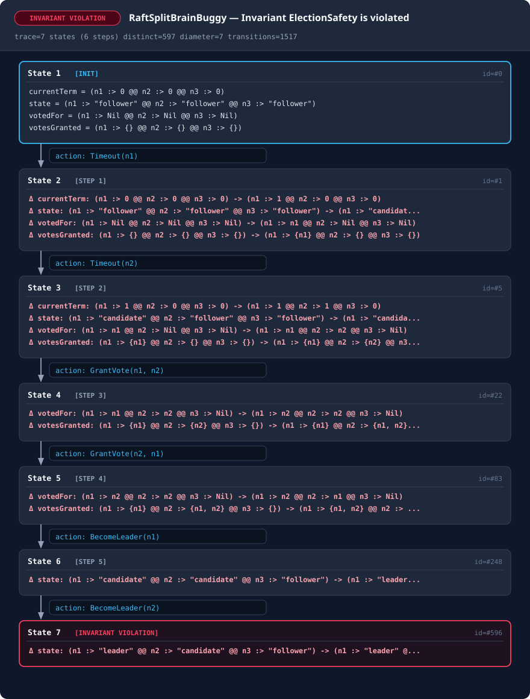

# moon-tla

Pure-MoonBit TLA+ distributed protocol model checker, official TLC-compatible engine, native SVG counterexample trace visualizer, and zero-upload browser studio.

- **Zero third-party dependencies** in the root library (`Sam-Hui-dot/moon-tla`), verified across all four MoonBit targets (`wasm`, `wasm-gc`, `js`, `native`) with `--deny-warn`.
- **Zero JVM dependency**: compiles directly to native binaries and browser JS/Wasm for millisecond-scale startup and interactive exploration.
- **Verified against official Java TLC `v1.7.4`** (`tlaplus/tlaplus` `tla2tools.jar`): **11/11** unmodified distributed protocol `.tla` + `.cfg` specs match exact verdict, exact distinct state counts, exact BFS diameters, and exact shortest counterexample lengths.
- **Interactive Zero-Upload Browser Studio**: [https://sam-hui-dot.github.io/moon-tla/](https://sam-hui-dot.github.io/moon-tla/) — edit real TLA+ specs in the browser, toggle one-line protocol defects (Raft split-brain, Two-Phase Commit, Peterson Mutex, Bank TOCTOU), and inspect native SVG counterexample timelines and state-space graphs without uploading any files.

## Counterexample Visualization Preview

Running `moon-tla` on `demo/specs/RaftSplitBrainBuggy.tla` (3-node Raft election with the single-vote-per-term guard omitted) detects the shortest 6-step dual-leader counterexample (`ElectionSafety`) and renders native SVGs directly from MoonBit:



## Official Java TLC `v1.7.4` Differential Oracle

All 11 specifications in `demo/specs/` are executed unmodified by both Native `moon-tla` (`--release`) and official Java `tlc2.TLC` (`tla2tools.jar v1.7.4`, `-workers 1` deterministic BFS) in `demo/verify_tlc.py` and in GitHub Actions CI:

| Protocol | Verdict (Both) | Distinct States (`moon-tla` / TLC) | Diameter (`moon-tla` / TLC) | Shortest Trace | Native `moon-tla` | JVM `TLC v1.7.4` | End-to-End Ratio |
| --- | --- | ---: | ---: | ---: | ---: | ---: | ---: |
| `DieHard` | `INVARIANT:NotSolved` | 14 / 14 | — | 7 states | 177.0 ms | 1102.4 ms | 6.2x |
| `TwoPhase` | `OK` | 288 / 288 | 11 / 11 | — | 41.9 ms | 769.2 ms | 18.4x |
| `TwoPhaseBuggy` | `INVARIANT:TCConsistent` | 158 / 158 | — | 6 states | 26.9 ms | 753.7 ms | 28.0x |
| `MutexPeterson` | `OK` | 26 / 26 | 8 / 8 | — | 31.0 ms | 922.3 ms | 29.7x |
| `MutexBuggy` | `INVARIANT:MutualExclusion` | 9 / 9 | — | 5 states | 18.3 ms | 738.9 ms | 40.4x |
| `RaftElection` | `OK` | 282 / 282 | 8 / 8 | — | 51.5 ms | 842.8 ms | 16.4x |
| `RaftSplitBrainBuggy` | `INVARIANT:ElectionSafety` | 597 / 597 | — | 7 states | 57.0 ms | 850.5 ms | 14.9x |
| `BankTransfer` | `OK` | 5 / 5 | 3 / 3 | — | 22.9 ms | 845.2 ms | 36.9x |
| `BankTransferBuggy` | `INVARIANT:NoOverdraft` | 15 / 15 | — | 5 states | 21.9 ms | 835.6 ms | 38.2x |
| `DiningPhilosophers` | `DEADLOCK` | 14 / 14 | — | 4 states | 23.7 ms | 953.6 ms | 40.3x |
| `TokenRing` | `OK` | 8 / 8 | 5 / 5 | — | 18.9 ms | 935.4 ms | 49.4x |
| **Total (11 specs)** | **11/11 EXACT** | **11/11 EXACT** | **5/5 EXACT** | **6/6 EXACT** | **490.9 ms** | **9549.6 ms** | **19.5x** |

*Measurement note: Wall-clock timings were recorded on Windows (JDK 17 vs MoonBit native release) and reflect end-to-end single-invocation CLI execution; on small-to-medium state spaces, JVM startup accounts for the majority of Java TLC's elapsed time.*

## Supported TLA+ & TLC Feature Set (`0.1.0`)

- **Parser (`lexer.mbt`, `parser.mbt`, `cfg.mbt`)**:
  - Module headers/footers (`---- MODULE Name ----` / `====`), `EXTENDS`, `CONSTANTS`, `VARIABLES`, `ASSUME`, `LOCAL`, line comments `\*`, nested block comments `(* ... *)`.
  - Indentation-sensitive vertical conjunction (`/\\`) and disjunction (`\\/`) bullet lists.
  - Full expression & action syntax: operator definitions, `LET ... IN`, `IF ... THEN ... ELSE`, `CASE ... [] ... [] OTHER -> ...`, `\A` / `\E` / `CHOOSE` (including multi-variable and `<<x, y>>` tuple patterns), sets (`{...}`, `{x \in S : P}`, `{e : x \in S}`, `SUBSET`, `UNION`, `a..b`, `\cup`, `\cap`, `\`, `\X`), functions & records (`[x \in S |-> e]`, `[S -> T]`, `[a |-> 1]`, `[a : S]`, `DOMAIN`, chained `[f EXCEPT ![k].field = @ + 1]`), tuples/sequences (`<<...>>`, `\o`), primes `x'`, `UNCHANGED`, `ENABLED`, `[Next]_vars`, `WF_vars(Next)`, `SF_vars(Next)`.
  - Standard `.cfg` directives: `SPECIFICATION`, `INIT`, `NEXT`, `INVARIANT`/`INVARIANTS`, `PROPERTY`/`PROPERTIES`, `CONSTANT`/`CONSTANTS` (scalars, model values, sets, `<-` overrides), `CHECK_DEADLOCK`.
- **Evaluator & Standard Modules (`value.mbt`, `eval.mbt`)**:
  - Total-order canonical `TlaVal` with unique normal forms (functions with domain `1..n` unified with sequences/tuples; records unified with string-keyed functions) and 128-bit state fingerprinting.
  - Built-in semantics for `Naturals`, `Integers` (floor/Euclidean `\div` and `%`), `Sequences` (`Len`, `Head`, `Tail`, `Append`, `SubSeq`, `SelectSeq`, `Seq`), `FiniteSets` (`Cardinality`, `IsFiniteSet`), and `TLC` (`:>`, `@@`, `Print`, `PrintT`, `Assert`, `ToString`).
  - Symbolic membership checks for infinite/large domains (`Nat`, `Int`, `STRING`, `BOOLEAN`, `[S -> T]`, `[a : S]`, `SUBSET S`, `Seq(S)`).
- **Model Checker & Liveness (`checker.mbt`, `liveness.mbt`)**:
  - Nondeterministic `Init` / `Next` constraint solver with deferred conjunct resolution and automatic top-level action name attribution.
  - Exact BFS exploration guaranteeing shortest safety/deadlock counterexample traces and TLC-aligned diameter computation.
  - Tarjan strongly connected component (SCC) cycle detection for temporal properties (`[]P`, `<>P`, `P ~> Q`, `[](P => <>Q)`) with lasso counterexample reconstruction.
- **Visualization & Reporting (`viz.mbt`, `report.mbt`)**:
  - Native SVG counterexample sequence timelines (`render_trace_svg`) with per-step variable diffs and lasso loop-back arcs.
  - Layered BFS state-space graph SVGs (`render_state_graph_svg`) with hover state snapshots.
  - Plain-text (TLC-style), Markdown, and structured JSON reports.

## Library Usage (MoonBit)

Add `Sam-Hui-dot/moon-tla` in `moon.mod`:

```moonbit
import {
  "Sam-Hui-dot/moon-tla@0.1.0",
}
```

Check a specification programmatically and render SVG / Markdown diagnostics:

```moonbit
fn main raise {
  let tla =
    #|---- MODULE Counter ----
    #|EXTENDS Integers
    #|VARIABLE x
    #|Init == x = 0
    #|Step == x < 5 /\ x' = x + 1
    #|Next == Step
    #|Bound == x < 3
    #|====
  let cfg = "INIT Init\nNEXT Next\nINVARIANT Bound"
  let result = @moon-tla.check_spec_sources(tla, cfg)
  println(@moon-tla.render_result_text(result))
  let svg = @moon-tla.render_trace_svg(result)
  println("SVG length: \{svg.length()}")
}
```

## CLI Usage

Build the native CLI:

```bash
moon build --target native --release cmd/main
```

Run model checking and export reports or SVGs:

```bash
# Terminal summary + shortest counterexample trace
./_build/native/release/build/cmd/main/main check demo/specs/RaftSplitBrainBuggy.tla \
  --cfg demo/specs/RaftSplitBrainBuggy.cfg

# Export native SVG counterexample timeline
./_build/native/release/build/cmd/main/main check demo/specs/RaftSplitBrainBuggy.tla \
  --cfg demo/specs/RaftSplitBrainBuggy.cfg \
  --format trace-svg --out trace.svg --exit-zero

# Export layered BFS state-space graph SVG
./_build/native/release/build/cmd/main/main check demo/specs/TwoPhaseBuggy.tla \
  --cfg demo/specs/TwoPhaseBuggy.cfg \
  --format graph-svg --out graph.svg --exit-zero

# Evaluate a standalone TLA+ expression
./_build/native/release/build/cmd/main/main eval "(-1) % 3"
```

## Development & Verification

```bash
# Format check + 4-target verification
moon fmt --check
for t in wasm wasm-gc js native; do
  moon check --target "$t" --deny-warn
  moon test --target "$t" --deny-warn
done

# Build and V8 smoke-test the zero-upload browser studio
python3 demo/build_web.py

# Run official Java TLC v1.7.4 differential oracle across all 11 specs
python3 demo/verify_tlc.py
```

## Current Scope & Roadmap

Current `0.1.0` scope boundaries:
- Explicit-state BFS in memory (`max_states` configurable, default `200,000`); symmetry reduction (`SYMMETRY Permutations(S)`) is parsed in `.cfg` but not yet applied during state canonicalization.
- Temporal properties cover `[]P`, `<>P`, `P ~> Q`, and `[](P => <>Q)` with weak fairness on `Next`; arbitrary nested Buchi LTL formulas and per-action `SF_v(A)` fairness constraints are planned for `0.2.0`.
- `INSTANCE ... WITH ...` multi-module imports, `RECURSIVE` operators, and PlusCal translation are planned for `0.2.0`–`0.3.0`.

Planned milestones:
- `0.2.0`: Symmetry reduction (`Permutations(S)`), per-action weak/strong fairness liveness parity with Java TLC, and `RECURSIVE` operators.
- `0.3.0`: PlusCal-to-TLA+ compiler frontend and `moon prove` verification of core canonical-set and fingerprinting invariants.
- `0.4.0`: Official `tlaplus/Examples` 25+ protocol regression suite, bit-packed state storage, and reusable GitHub Action (`action.yml`).

## License

Apache-2.0
